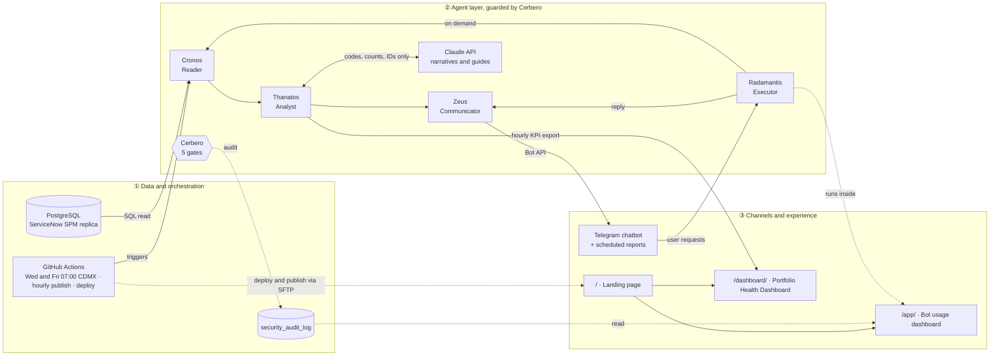

# SPM Status Report AI Ecosystem — Architecture

> Purpose of this file: a complete, self-contained description of the system that another LLM can read to answer
> questions, propose changes, or generate code without access to the repository. Facts are stated as implemented;
> anything not implemented is marked **Not implemented**.

## 1. One-paragraph summary

A Python system reads project data from a PostgreSQL replica of ServiceNow SPM, computes the 19 standard
status-report KPIs with five cooperating agents, and delivers them through three channels: (1) scheduled status
reports on Telegram (Wednesday and Friday at 07:00 America/Mexico_City), (2) an interactive Telegram chatbot
answering 7 query types in real time, and (3) web dashboards on hatchvps.com (a React "Portfolio Health Dashboard"
refreshed hourly and a Streamlit "bot usage" dashboard with the security audit log). A security agent (Cerbero)
inspects every agent action and writes a hash-chained audit log. Claude (Anthropic API) writes executive narratives
and an "how to correct" guide at the end of every report, receiving only KPI codes, counts and IDs.

## 2. Components

| ID | Component | Type | Responsibility | Code location |
|---|---|---|---|---|
| C1 | **Cronos** | Agent 1 · Reader | Connects to the DB, reads projects, status reports and auxiliary tables, applies 10 data-quality rules (DQ-01…DQ-10), keeps data in memory, emits a completion signal, produces a failure report on errors | `src/spm_sr/cronos/` |
| C2 | **Thanatos** | Agent 2 · Analyst | Computes KPIs 1–19, compares declared vs calculated health, builds program/portfolio roll-ups, requests AI narratives and AI corrective guides | `src/spm_sr/thanatos/` |
| C3 | **Zeus** | Agent 3 · Communicator | Renders and sends Telegram messages (one per PM, Program Manager, Portfolio Manager), charts per bot option, idempotent per shift | `src/spm_sr/zeus/` |
| C4 | **Radamantis** | Agent 4 · Executor | Receives chatbot requests in real time, runs Cronos → Thanatos, asks Zeus to reply; runs in a background thread inside the web app on the server | `src/spm_sr/radamantis/` |
| C5 | **Cerbero** | Agent 5 · Security | 5 security gates on every agent action; quarantines abusive chats; halts compromised agents; hash-chained audit log | `src/spm_sr/cerbero/` |
| C6 | Orchestrator | Pipeline | Cronos → Thanatos → Zeus with conditional edges on agent signals (COMPLETED / PARTIAL / FAILED); contract validation C1/C2/C3 (Pydantic) | `src/spm_sr/core/orchestrator.py` |
| C7 | PostgreSQL | Data store | ServiceNow SPM replica + `security_audit_log` table | course server `alumnos-db` |
| C8 | Claude API | External AI | Narratives and corrective guides | Anthropic Messages API |
| C9 | Telegram Bot API | External channel | Scheduled reports and chatbot (long polling) | api.telegram.org |
| C10 | GitHub Actions | Scheduler / CI/CD | Scheduled runs, hourly dashboard publish, bot deploy via SFTP, SSH tunnel to DB, tests | `.github/workflows/` |
| C11 | Web landing | Static page | "Proyecto Final Edgar Cruz" section with links to both dashboards (PepsiCo palette) | `scripts/build_landing.py` → `/` |
| C12 | Bot usage dashboard | Streamlit app | Bot status, requests, last DB query (top-right), summary, Cerbero audit log with chain integrity | `app.py` → `/app/` |
| C13 | Portfolio Health Dashboard | React 18 + Recharts (Vite) | All 19 KPIs in charts, filters, bar/column/donut toggle, "Last DB query" (top-right), PDF export of the current view | `dashboard/` → `/dashboard/` |
| C14 | KPI snapshot | Static JSON | Hourly export by Cronos → Thanatos (no credentials, no emails, no chat IDs) | `scripts/export_dashboard_data.py` → `/dashboard/data/kpis.json` |

## 3. Diagram

## 4. Data flows

| Flow | Trigger | Path | Output |
|---|---|---|---|
| F1 Scheduled status report | GitHub Actions cron `0 13 * * 3,5` (Wednesday and Friday 07:00 CDMX) | SSH tunnel → Cronos → Thanatos (+ Claude) → Zeus → Telegram | One message per manager, ending with an AI corrective guide; idempotent per date + run (`SR_SLOT` = scheduled / manual) |
| F2 Chatbot request | User message on Telegram | Telegram → Cerbero inbound → Radamantis → Cronos (cached 60 s) → Thanatos → Claude guide → Zeus (outbound gate) → Telegram | Text + chart (PNG) + AI guide |
| F3 Dashboard refresh | GitHub Actions every hour (`7 * * * *`) | SSH tunnel → Cronos → Thanatos → `kpis.json` → Vite build → SFTP to `/www/dashboard/` | Portfolio Health Dashboard with fresh data |
| F4 Bot deploy | Manual workflow | Package `spm_sr.zip` + `app.py` + JSON config + `.env` → SFTP | Server restarts `app.py`, bot thread starts (long polling) |
| F5 Security audit | Every agent action | Cerbero gate → `security_audit_log` (hash chain per session) | Visible in `/app/` (masked chat IDs, reason codes, no content) |

## 5. KPIs (19)

| Group | KPIs | Examples of fields |
|---|---|---|
| Health (1–5) | Overall, Schedule, Cost, Resources, Scope — calculated vs PM-declared (Consistent / Optimistic / Conservative / Not comparable) | Green / Amber / Red / No data |
| Performance (6–13) | % complete vs expected (linear), planned/actual start and end, end variance, planned vs actual cost, CPI, budget used, planned vs actual effort | `pctComplete`, `cpi`, `budgetUsedPct` |
| Control (14–19) | Milestones (done/overdue), open risks (high), open issues, pending decisions, pending/overdue actions, pending change requests | counts per project, summed in roll-ups |

Data-quality rules: DQ-01 missing status report · DQ-02 stale status report · DQ-03 invalid % complete ·
DQ-04 invalid/empty planned dates · DQ-05 progress without actual start · DQ-06 missing planned cost or effort ·
DQ-07 no PM or PM without email · DQ-08 empty declared health · DQ-09 duplicate record · DQ-10 missing region.

## 6. Chatbot (Telegram) interface

| Option | Command | Answer |
|---|---|---|
| 1 | `/total` | Total, active, closed/cancelled, analyzed, calculated health distribution |
| 2 | `/categories` | Open / In progress / On hold / Closed / Cancelled with raw states |
| 3 | `/regions` | Projects and active projects per region (custom field `u_region`) |
| 4 | `/programs` | Projects and health per program |
| 5 | `/portfolios` | Projects and health per portfolio |
| 6 | `/dataquality` | Projects with data-quality findings by rule |
| 7 | `/status <ID>` or just the ID | All 19 KPIs for a project (`PRJ…`), program (`PRG…`) or portfolio (`PFL…`) |

Every option returns a chart and ends with "🧭 AI guide · how to correct" (or a labeled rule-based guide if AI is
unavailable). Spanish command aliases still work. Only allow-listed chat IDs get data.

## 7. AI usage and controls

| Use | Input sent to Claude | Validation | Fallback |
|---|---|---|---|
| Executive narrative (programs/portfolios first, ≤60 calls per run) | Roll-up / project KPI JSON | Every number must exist in the input; Cerbero `llm_out` (no links, HTML, secrets, instructions) | Deterministic template |
| Corrective guide (one per report / bot answer, cached by situation signature) | Only situation codes, labels, counts and validated IDs — no free text from the DB | Same as above | Rule-based playbook, labeled as such |

The system prompt declares the JSON untrusted and forbids following instructions inside it.

## 8. Security (Cerbero)

| Gate | Agent | Checks | Action |
|---|---|---|---|
| inbound | Radamantis | Authorization, ≤300 chars, ≤12 requests/min, control characters, prompt/SQL/command/HTML injection | BLOCK; 3 blocks in 10 min → 30-min quarantine (no replies) |
| data | Cronos | Every text field from the DB | Malicious field → `[removed by security]`, record flagged; >20 % flagged → HALT run |
| llm_in | Thanatos | Flagged records never reach the AI | Template instead |
| llm_out | Thanatos | AI output: links, HTML, secrets, instructions, length | BLOCK → template |
| outbound | Zeus | Secrets (tokens, API keys, DB URLs, private keys), recipient allow-list, disallowed HTML, foreign links | Secret or foreign recipient → HALT Zeus; links/HTML stripped |

Audit record fields: `ts, source, session, agent, action, gate, decision, severity, reasons, subject (masked),
content_sha256, excerpt (blocked items only), prev_hash, hash`. Other controls: secrets only in GitHub Actions
secrets and the server `.env` (verified not public, HTTP 404); public repository contains no credentials (CI test);
workflow inputs passed via environment variables and validated.

## 9. Deployment and runtime constraints

| Constraint | Design decision |
|---|---|
| Course server keeps only `app.py` alive; other `.py` files run as 150-second scripts without libraries | Bot runs in a thread inside `app.py`; package shipped as `spm_sr.zip`; config shipped as JSON |
| Every file under `/www` is public | No log or audit files on the server; audit goes to the DB |
| SSH (port 22) unreachable from the authoring environment | All SFTP/tunnel steps run in GitHub Actions with a secret key |
| DB limit: 8 connections, 60 s per query | Cached reads (60 s) in the bot; audit writer pool of 1 |

## 10. Web pages

| Path | Content |
|---|---|
| `/` | Original hosting welcome page restyled with the PepsiCo palette, with the "Proyecto Final Edgar Cruz" section first: agent description and links to both dashboards |
| `/app/` | Bot usage dashboard: status (listening/created/stopped), requests, errors, authorized chats, last DB query (top-right), summary tables, Cerbero audit log (24 h counters, chain integrity, filterable table) |
| `/dashboard/` | Portfolio Health Dashboard: 7 summary tiles, sections Health / Performance / Control / Breakdown / Data quality / Projects, filters (portfolio, program, region, category, health, PM, search, active/all), chart-type toggle, project drawer with all 19 KPIs, "Download PDF" (A4 landscape, page breaks between cards) |

## 11. Visual identity

PepsiCo-inspired palette (secondary source, Coloropedia): navy `#28458E`, electric blue `#0096D6`, tangelo `#EB7B30`.
Chart series `#3D63C4`, `#EB7B30`, `#0096D6`, `#6250D6`, `#E87BA4`, other `#A7AEBB`. Status colors are reserved:
Green `#00984A`, Amber `#E0A000`, Red `#DF002C`, No data `#A7AEBB`. Font: Inter.

## 12. Key numbers

| Metric | Value |
|---|---|
| Agents | 5 (Cronos, Thanatos, Zeus, Radamantis, Cerbero) |
| KPIs | 19 |
| Bot options | 7, each with a chart |
| Scheduled status reports | 2 per week (Wed and Fri) |
| Dashboard refresh | hourly |
| Security gates | 5 |
| Data-quality rules | 10 |
| Automated tests | 114 (at 2026-10-18) |
| Demo dataset | 150 projects, 129 active, ~69 recipients per run |

## 13. Not implemented / limitations

- Email channel (removed: no SMTP server available).
- Real-time DB streaming to the dashboard (hourly snapshot instead).
- Quarantine state persists only in the bot process memory (reset on server restart).
- Security rules are pattern-based: they reduce risk, they do not eliminate it.
- Data is synthetic; record names (projects, regions, people) are stored in Spanish.

## 14. Glossary

SPM: Strategic Portfolio Management (ServiceNow) · SR: Status Report · PM / PgM / PfM: Project / Program / Portfolio
Manager · CPI: Cost Performance Index (EV/AC) · DQ: data quality · HALT: Cerbero stops an agent action ·
CDMX: America/Mexico_City (UTC-6).
