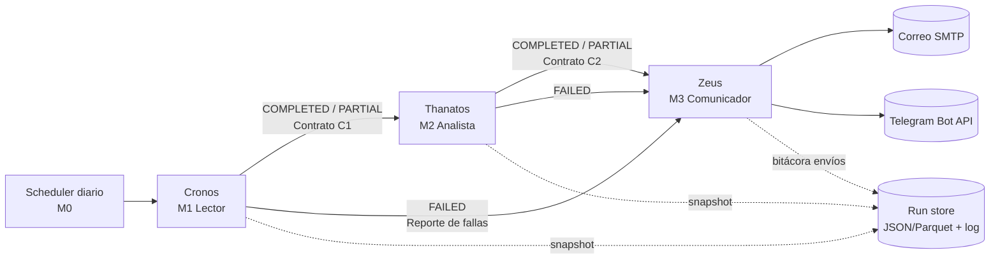

# 01 · Arquitectura y Flujo

## Conclusión
Pipeline **secuencial con estado compartido** (grafo lineal con una bifurcación por error). Cada agente lee del estado, escribe su sección y emite una señal (`COMPLETED | PARTIAL | FAILED`). El orquestador decide la siguiente transición.

## Flujo


| Transición | Condición | Acción |
|---|---|---|
| Cronos → Thanatos | `COMPLETED` o `PARTIAL` (≥1 proyecto válido) | Thanatos procesa solo registros válidos; los excluidos viajan como hallazgos de calidad |
| Cronos → Zeus | `FAILED` (sin conexión o 0 registros válidos) | Zeus envía **solo** el reporte de fallas al Administrador técnico; no se envía SR a PMs |
| Thanatos → Zeus | `COMPLETED` / `PARTIAL` | Zeus envía SR por destinatario |
| Thanatos → Zeus | `FAILED` | Zeus envía alerta técnica; no se envía SR |

## Responsabilidades (principio: un agente, una responsabilidad)
| Agente | Tipo | Usa LLM | Por qué |
|---|---|---|---|
| Cronos | Determinista | No (opcional para redactar el reporte de fallas) | Leer y validar datos no requiere razonamiento generativo |
| Thanatos | Híbrido | Sí, **solo narrativa** | KPIs en código (trazables); el LLM resume con valores ya calculados |
| Zeus | Determinista + plantilla | Opcional (tono del mensaje) | Envío y enrutamiento deben ser predecibles |

## Stack propuesto (SUPUESTO — ajustable)
| Capa | Propuesta | Alternativa |
|---|---|---|
| Lenguaje | Python 3.11+ | — |
| Orquestación de agentes | **Implementado: orquestador propio en Python** (`src/spm_sr/core/orchestrator.py`), misma semántica de estado tipado + aristas condicionales, sin dependencias extra | LangGraph / CrewAI (proceso secuencial) |
| Acceso a BD | SQLAlchemy 2.x (agnóstico al motor) | Conector nativo del RDBMS |
| Contratos | Pydantic v2 | dataclasses + JSON Schema |
| LLM | Claude vía API (narrativa Thanatos) | Cualquier LLM con salida estructurada |
| Correo | SMTP (Gmail/O365) o Gmail API | SendGrid |
| Mensajería | Telegram Bot API (`sendMessage`) | — |
| Scheduler | Windows Task Scheduler / cron | APScheduler dentro del servicio |
| Persistencia de corrida | Carpeta `runs/AAAA-MM-DD/` (JSON + log) | Tabla `sr_run` en la misma BD local |

## Estructura de repositorio
```
spm-sr-agents/
├── config/            # settings.yaml, thresholds.yaml, recipients (sin secretos)
├── src/
│   ├── core/          # M0: orquestador, estado, logging, errores
│   ├── contracts/     # C1, C2, C3 (Pydantic)
│   ├── cronos/        # M1
│   ├── thanatos/      # M2: kpi_rules.py, rollup.py, narrative.py
│   ├── zeus/          # M3: email.py, telegram.py, templates/
├── tests/             # unit, contract, integration, fixtures SQL
├── runs/              # snapshots por corrida (gitignored)
└── main.py            # punto de entrada del scheduler
```

## Qué falta verificar
- Si el entorno de entrega permite servicios externos (API LLM, SMTP, Telegram) desde la máquina donde corre la réplica.
- Si el curso exige un framework de agentes específico.
