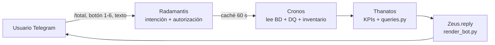

# 11 · M5 — Agente "Radamantis" (Ejecutor) · Bot de Telegram bajo demanda

## Conclusión
Radamantis recibe peticiones del bot en tiempo real y **reutiliza** los agentes existentes: Cronos lee la BD, Thanatos analiza/consulta y Zeus responde en el mismo chat. No duplica lógica ni usa LLM (cifras 100 % de código).

## Flujo

## Opciones del bot
| # | Comando | Respuesta | Fuente |
|---|---|---|---|
| 1 | `/total` | Total, activos, cerrados/cancelados, analizados, excluidos DQ, salud calculada | `pm_project` (inventario) |
| 2 | `/categorias` | Abierto / En progreso / En pausa / Cerrado / Cancelado, con estados originales | `pm_project.state` |
| 3 | `/regiones` | Proyectos y activos por región | `pm_project.u_region` (**campo personalizado, SUPUESTO**) |
| 4 | `/programas` | Proyectos (activos) y salud 🟢🟡🔴 por programa; programas sin proyectos | `pm_project.primary_program` |
| 5 | `/portafolios` | Igual, por portafolio | `pm_project.primary_portfolio` |
| 6 | `/calidad` | Proyectos con problemas de datos agrupados por regla DQ-01…DQ-10 | Reglas DQ de Cronos |

## Decisiones
| Tema | Decisión | Etiqueta |
|---|---|---|
| Región | OOB no tiene región; se agrega `u_region` (convención de campos propios en ServiceNow) | SUPUESTO |
| Cerrados | Cronos expone `inventory` (todos los proyectos del alcance) sin cambiar el análisis diario | HECHO |
| Seguridad | Solo responde a chats autorizados (`TELEGRAM_CHAT_ID`, `BOT_ALLOWED_CHAT_IDS`, `RECIPIENTS_YAML`) | HECHO |
| Carga a la BD | Caché de 60 s: varias consultas seguidas usan una sola lectura (límite: 8 conexiones) | HECHO |
| Hosting | Servidor del curso (hatchvps). Solo `app.py` vive de forma permanente (los `.py` sueltos corren 150 s en un entorno sin librerías), así que el bot arranca **dentro de `app.py`** en un hilo; el código va en `spm_sr.zip` para que el servidor no ejecute los módulos. Publicación: workflow `deploy_bot.yml`; despertador horario: `bot_keepalive.yml` | HECHO |

## Qué falta verificar
- Que el servidor no recicle la app con frecuencia (el despertador horario la reactiva, con hasta ~1 h de hueco).
- Alta de chats de otros usuarios (PM/PgM/PfM) en `BOT_ALLOWED_CHAT_IDS`.
