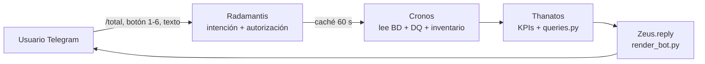

# 11 · M5 — Agente "Radamantis" (Ejecutor) · Bot de Telegram bajo demanda

## Conclusión
Radamantis recibe peticiones del bot en tiempo real y **reutiliza** los agentes existentes: Cronos lee la BD, Thanatos analiza/consulta y Zeus responde en el mismo chat. No duplica lógica ni usa LLM (cifras 100 % de código).

## Flujo

## Opciones del bot
El bot responde en **inglés** (textos, botones, comandos y gráficas; traducción en `zeus/i18n.py`). Los nombres guardados en la BD (proyectos, regiones, personas) se muestran tal cual. Los comandos en español (`/categorias`, `/calidad`, `/estatus`…) siguen funcionando como alias.

| # | Comando | Respuesta | Fuente |
|---|---|---|---|
| 1 | `/total` | Total, activos, cerrados/cancelados, analizados, excluidos DQ, salud calculada | `pm_project` (inventario) |
| 2 | `/categories` | Open / In progress / On hold / Closed / Cancelled, con estados originales | `pm_project.state` |
| 3 | `/regions` | Proyectos y activos por región | `pm_project.u_region` (**campo personalizado, SUPUESTO**) |
| 4 | `/programs` | Proyectos (activos) y salud 🟢🟡🔴 por programa; programas sin proyectos | `pm_project.primary_program` |
| 5 | `/portfolios` | Igual, por portafolio | `pm_project.primary_portfolio` |
| 6 | `/dataquality` | Proyectos con problemas de datos agrupados por regla DQ-01…DQ-10 | Reglas DQ de Cronos |

## Gráficas (una por opción, `zeus/charts.py`)
| Opción | Forma | Por qué |
|---|---|---|
| 1 Total | Barras por estado de salud | Comparar magnitudes de 4 estados |
| 2 Categoría | Barras ordenadas, un tono | Magnitud por categoría, con % |
| 3 Región | Barras apiladas activos / cerrados | Total y composición en un solo eje |
| 4-5 Programa / Portafolio | Barras apiladas por salud (top 15) | Dónde se concentran proyectos y riesgo |
| 6 Calidad | Barras por regla, color = severidad | Qué falta y qué tan grave |
| 7 Proyecto | Matriz calculado vs declarado + barras de % (avance real/esperado, presupuesto y esfuerzo consumidos) | Ver optimismo y desvío en una imagen |
| 7 Programa / Portafolio | Barras 100 % apiladas por KPI | Distribución de cada KPI de salud |

Paleta de estado fija (bueno/advertencia/crítico + gris "sin dato"); cada gráfica lleva leyenda y el valor escrito (mitigación del bajo contraste del amarillo, validada con el validador del skill dataviz). Si la gráfica falla, el texto ya llegó.

## Decisiones
| Tema | Decisión | Etiqueta |
|---|---|---|
| Región | OOB no tiene región; se agrega `u_region` (convención de campos propios en ServiceNow) | SUPUESTO |
| Cerrados | Cronos expone `inventory` (todos los proyectos del alcance) sin cambiar el análisis diario | HECHO |
| Seguridad | Solo responde a chats autorizados (`TELEGRAM_CHAT_ID`, `BOT_ALLOWED_CHAT_IDS`, `RECIPIENTS_YAML`) | HECHO |
| Carga a la BD | Caché de 60 s: varias consultas seguidas usan una sola lectura (límite: 8 conexiones) | HECHO |
| Hosting | Servidor del curso (hatchvps). Solo `app.py` vive de forma permanente (los `.py` sueltos corren 150 s en un entorno sin librerías), así que el bot arranca **dentro de `app.py`** en un hilo; el código va en `spm_sr.zip` para que el servidor no ejecute los módulos. Publicación: workflow `deploy_bot.yml`; despertador horario: `bot_keepalive.yml` | HECHO |

## Qué falta verificar
- Que el servidor no recicle la app con frecuencia (el despertador horario la reactiva, con hasta ~1 h de hueco).
- Alta de chats de otros usuarios (PM/PgM/PfM) en `BOT_ALLOWED_CHAT_IDS`.
